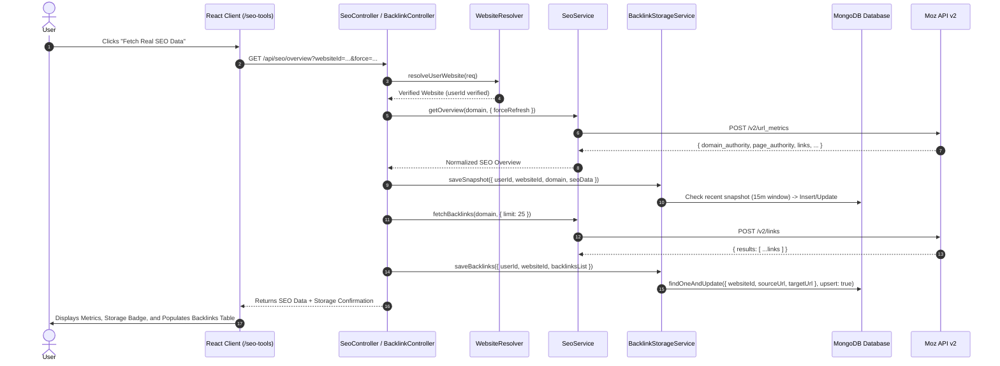

# LINKORA — SEO & Backlink Management Automation Platform

> A premium, modern, visually impressive SaaS platform for SEO & Backlink Management inspired by *backlinkmanagement.io*.


-blue?style=for-the-badge)


---

## 1. Project Overview

**LINKORA** is a centralized command center for modern SEO teams, growth leads, and link builders. The platform provides real-time visibility into backlink acquisition, link profile health, content production velocity, and automated alerts for lost high-authority backlinks.

**Phase 2 includes:**
- **Complete Dashboard Module**: Multi-series backlink growth charts, link attributes donut, recent backlinks table, live activity timeline, monthly content progress, and actionable alerts.
- **Full Backend Database & Dual Authentication (Local + Google OAuth 2.0)**:
  - MongoDB database integration with Mongoose.
  - User model supporting both email/password accounts and Google OAuth accounts.
  - Safe account linking: Existing local accounts can be safely linked with Google accounts using the same verified email.
  - Google-only accounts work without requiring a password.
  - Password hashing with bcrypt (10 rounds).
  - Passport.js Local Strategy & Passport Google OAuth 2.0 Strategy (`passport-google-oauth20`).
  - MongoDB-backed persistent session storage using `connect-mongo`.
  - Rate limiting on authentication endpoints to prevent brute-force abuse.
  - Protected API routes and protected React routes.
  - Dedicated, beautifully styled Login and Signup pages with **"Continue with Google"** buttons.

---

## 2. Technology Stack

### Frontend
- **React 18** (Functional components, custom hooks, React Context)
- **Vite** (Ultra-fast build & development tooling)
- **JavaScript** (Modern ES modules, no TypeScript)
- **Tailwind CSS** (Custom dark theme with emerald growth accents `#10B981`, surfaces `#15191E`, `#1B2026`)
- **React Router DOM v6** (Nested layout routing, deep links, protected routes)
- **Recharts** (Interactive multi-series backlink growth area charts, donut distribution)
- **Lucide React** (Clean, consistent iconography)

### Backend
- **Node.js** (v18+)
- **Express.js** (REST API)
- **MongoDB & Mongoose** (Data modeling, schema validation, and persistence)
- **Passport.js & Passport Local Strategy** (Session-based user authentication)
- **Passport Google OAuth 2.0** (`passport-google-oauth20` for Google Sign-In)
- **Express Session & connect-mongo** (MongoDB-backed persistent session store)
- **bcryptjs** (Secure 10-round password hashing)
- **express-rate-limit** (Brute-force protection on auth endpoints)
- **CORS** (`credentials: true` for secure cross-origin cookie sharing)
- **Dotenv** (Environment configuration)

---

## 3. Architecture & Folder Structure

```
Backlink-Management-Project/
├── .gitignore                      # Git ignore rules for node_modules, env, logs, dist
├── package.json                    # Root scripts & dev dependencies (concurrently)
├── README.md                       # Complete documentation
├── server/
│   ├── .env.example                # Sample environment variables
│   ├── .env                        # Local environment variables (with Google credentials)
│   ├── package.json                # Server dependencies
│   ├── server.js                   # HTTP server entrypoint (port 5002 and compatibility listener on 5000)
│   ├── app.js                      # Express application, sessions, CORS, Passport, routes
│   ├── config/
│   │   ├── db.js                   # Reusable Mongoose connection with embedded fallback
│   │   └── passport.js             # Passport Local + Google OAuth 2.0 configuration
│   ├── models/
│   │   └── User.js                 # User schema (googleId, avatar, providers, safe DTO)
│   ├── middleware/
│   │   ├── authMiddleware.js       # ensureAuthenticated & ensureAdmin middleware
│   │   └── rateLimiter.js          # express-rate-limit for auth endpoints
│   ├── routes/
│   │   ├── authRoutes.js           # Auth routes (/signup, /login, /logout, /me, /status, /google)
│   │   ├── dashboardRoutes.js      # Protected dashboard metrics routes
│   │   └── campaignRoutes.js       # Protected campaign creation routes
│   ├── controllers/
│   │   ├── authController.js       # Signup, login, logout, me, status, Google OAuth logic
│   │   ├── dashboardController.js  # Dashboard overview, growth, backlinks, alerts
│   │   └── campaignController.js   # Campaign management & activity sync
│   └── data/
│       ├── mockDashboard.js        # Overview KPIs, websites list, sparklines
│       ├── mockGrowth.js           # Growth series (7D, 30D, 90D, 12M)
│       ├── mockBacklinks.js        # Detailed recent backlinks table data
│       ├── mockActivity.js         # Real-time activity timeline feed
│       ├── mockContent.js          # Content production metrics & monthly target
│       └── mockAlerts.js           # Actionable alerts (lost links, review, errors)
└── client/
    ├── index.html                  # HTML5 shell with Google Inter font
    ├── package.json                # Frontend dependencies
    ├── vite.config.js              # Vite config with API proxy
    ├── tailwind.config.js          # Tailored dark theme design system
    ├── postcss.config.js           # PostCSS configuration
    └── src/
        ├── index.css               # Global CSS & scrollbar styling
        ├── main.jsx                # Application entrypoint
        ├── App.jsx                 # Route hierarchy, AuthProvider & protected routes
        ├── api/
        │   ├── apiService.js       # Dashboard API service with session credentials
        │   └── authService.js      # Auth API service (signup, login, logout, me)
        ├── context/
        │   ├── AuthContext.jsx     # User authentication state (user, login, signup, logout)
        │   ├── DashboardContext.jsx# Dashboard state (website, date range, charts)
        │   └── ToastContext.jsx    # Toast notification engine
        ├── components/
        │   ├── auth/
        │   │   └── ProtectedRoute.jsx # Route guard with session verification
        │   ├── common/             # Toast, Modal, StatusBadge, Skeletons, SearchPalette
        │   └── dashboard/          # Welcome, KPIs, Charts, Tables, Timelines, Alerts
        ├── layouts/
        │   ├── MainLayout.jsx      # Shell layout wrapper & modal mounts
        │   ├── Sidebar.jsx         # Responsive sidebar with dynamic user profile & avatar
        │   └── TopHeader.jsx       # Header with user avatar, logout & notifications
        ├── pages/
        │   ├── LoginPage.jsx       # Login page with "Continue with Google"
        │   ├── SignupPage.jsx      # Signup page with "Continue with Google"
        │   ├── DashboardPage.jsx   # Primary dashboard module
        │   └── ComingSoonPage.jsx  # Polished placeholder for future modules
        └── utils/
            ├── formatters.js       # Number formatting, compact values (K/M), percentages
            └── exportCsv.js        # Client-side dynamic CSV generator
```

---

## 4. Installation & Setup

### Prerequisites
- **Node.js** (v18.0.0 or later)
- **npm** (v9.0.0 or later)

### Quick One-Step Setup
Run the following from the root directory:
```bash
npm run install:all
```

---

## 5. Running the Application

### Option A: Run Frontend & Backend Concurrently (Recommended)
From the project root:
```bash
npm run dev
```
- **Backend API**: [`http://localhost:5002`](http://localhost:5002)
- **Frontend Dashboard**: [`http://localhost:5173`](http://localhost:5173)

### Option B: Run Individually
```bash
# Backend Server
npm run server

# Frontend Client
npm run client
```

---

## 6. Authentication & Google OAuth Details

### Google OAuth Flow
1. User clicks **"Continue with Google"** on either `/login` or `/signup`.
2. Frontend redirects to `http://localhost:5002/api/auth/google`.
3. Backend redirects user to Google's consent screen (`https://accounts.google.com/o/oauth2/v2/auth`).
4. User selects Google account and approves requested scopes (`profile`, `email`).
5. Google redirects back to `http://localhost:5000/auth/google/callback` (or `http://localhost:5002/api/auth/google/callback`).
6. The backend verifies the profile, creates a new user or safely links to an existing user with the same email, establishes an authenticated session (`req.login`), and redirects to `http://localhost:5173/?oauth=success`.
7. The user lands directly on the Dashboard, with their Google profile photo and name displayed in the header and sidebar.

### Authentication APIs (`/api/auth`)

| Method | Endpoint | Access | Purpose |
|---|---|---|---|
| `POST` | `/api/auth/signup` | Public | Register new user with email/password; hashes password & logs in (Rate limited) |
| `POST` | `/api/auth/login` | Public | Authenticates credentials via Passport Local Strategy and establishes session (Rate limited) |
| `POST` | `/api/auth/logout` | Authenticated | Terminates Passport login, destroys MongoDB session, and clears `connect.sid` cookie |
| `GET` | `/api/auth/me` | Authenticated | Returns current authenticated user object (safe DTO, excluding password) |
| `GET` | `/api/auth/status` | Public | Returns `{ success: true, isAuthenticated: boolean, user: Object \| null }` |
| `GET` | `/api/auth/google` | Public | Initiates Google OAuth consent flow |
| `GET` | `/api/auth/google/callback` | Public | Handles Google OAuth verification & session establishment |
| `GET` | `/auth/google/callback` | Public | Direct root callback endpoint for Google Cloud Console compatibility |

---

## 8. Phase 3: Website Management & DNS Domain Verification

Phase 3 introduces workspace management, allowing authenticated users to register their domains and prove ownership via real DNS TXT lookups:

- **Website Model**: Scoped to user ID, normalized domain, verification status (`pending` / `verified`), unique verification token, and active workspace flag.
- **DNS TXT Verification**:
  - Target Host: `_linkora-verification.<domain>`
  - Value: `linkora-verification=<token>`
  - Real DNS resolution via Node's native `dns.promises.resolveTxt`.
  - Diagnostic failure reporting (shows detected records like SPF and propagation tips).
- **Active Workspace Selection**: Persistent across sessions and shared globally through `WebsiteContext`.
- **Management Page**: [`/websites`](http://localhost:5173/websites) with Add, Edit, Delete, Verify modals and status badges.

---

## 9. Phase 4: SEO Data Provider Integration (Moz API & DataForSEO)

### Overview & Dual-Provider Architecture

Phase 4 integrates a real external SEO data provider into the backend to fetch genuine SEO metrics, authority ratings, and backlink statistics for the user's active domain.

The system features a **pluggable dual-provider architecture**:
1. **Moz API (Default Active Provider)**: Utilizes official **Moz API v2 (`lsapi.seomoz.com/v2/url_metrics`)** via the Free Community plan (no upfront payment or credit card required).
2. **DataForSEO (Preserved for Future Production Use)**: Fully preserved in the codebase for easy reactivation when organization funding becomes available.

Switching providers requires changing a single environment variable in `server/.env`:
```env
SEO_PROVIDER=moz          # Default: uses Moz API Links v2
# or
SEO_PROVIDER=dataforseo   # Uses DataForSEO Backlinks v3 Live API
```

---

### Moz API Integration Details

- **Official API**: Moz API v2 (URL Metrics endpoint: `POST https://lsapi.seomoz.com/v2/url_metrics`)
- **Authentication**: `x-moz-token` header (generated from the [Moz API Dashboard](https://moz.com/api/dashboard))
- **Cost & Limits**: Free Community Tier provides monthly row quotas (1 request per 10 seconds rate limit).
- **Supported Metrics**:
  - **Moz Domain Authority (DA)**: Genuine 0–100 score forecasting search engine ranking strength.
  - **Moz Page Authority (PA)**: Genuine 0–100 score predicting ranking strength for specific pages.
  - **Total Backlinks**: External inbound hyperlinks targeting the root domain.
  - **Referring Domains**: Unique root domains containing inbound links.
  - **Spam Score**: Percentage of sites with similar link patterns penalized by Google.
- **Metrics Unavailable in Moz Free URL Metrics (Honestly Disclosed)**:
  - Dofollow / nofollow equity breakdown (requires paid Moz Link Explorer or DataForSEO)
  - Broken backlink crawl detection
  - Daily new / lost backlink time-series deltas (reserved for Phase 5 database snapshots)
- **Trademark Notice**: *Domain Authority* and *Page Authority* are registered trademarks of Moz, Inc. Attribution is prominently displayed.

---

### DataForSEO Integration Details (Preserved)

- **API**: DataForSEO v3 Backlinks Live (`POST https://api.dataforseo.com/v3/backlinks/summary/live`)
- **Authentication**: HTTP Basic Auth (`DATAFORSEO_LOGIN`, `DATAFORSEO_PASSWORD`)
- **Billing**: Pay-as-you-go (~$0.025 per live query)
- **Features**: Raw link graph rank (0–1000), dofollow/nofollow ratio, referring IPs, and broken backlinks.

---

### Cost Safeguards & Rate-Limit Protection

- **In-Memory TTL Caching**: Successful responses are cached in memory for **60 minutes** (`seoCache`, namespaced by provider ID and domain). Cache hits cost \$0.00 and incur 0 rate limits.
- **15-Second Cooldown**: Prevents rapid repeated button clicks for the same domain across all users.
- **12-Second Timeout**: Managed via `AbortController` to safeguard against hung requests.
- **Zero Startup Queries**: No third-party API calls are made during app boot or initialization.

---

### Environment Configuration

Configure `server/.env` based on your preferred provider:

```env
# -------------------------------------------------------------
# SEO DATA PROVIDER CONFIGURATION
# -------------------------------------------------------------
# Choose active provider: "moz" (default) or "dataforseo"
SEO_PROVIDER=moz

# Option A: Moz API (Recommended for Development)
# Generate your free token at: https://moz.com/api/dashboard
MOZ_API_TOKEN=your_moz_api_token_here

# Option B: DataForSEO API (Preserved for Future Production)
# Register at: https://app.dataforseo.com/register
DATAFORSEO_LOGIN=your_dataforseo_login_email
DATAFORSEO_PASSWORD=your_dataforseo_api_password
```

---

### Implemented Endpoints (`/api/seo`)

| Method | Endpoint | Access | Purpose |
| :--- | :--- | :--- | :--- |
| `GET` | `/api/seo/provider-status` | Authenticated | Reports active provider identity, configuration state, docs URL, and supported metrics |
| `GET` | `/api/seo/overview` | Authenticated | Normalized SEO overview (DA, PA, total backlinks, referring domains, spam score) |
| `GET` | `/api/seo/domain-metrics` | Authenticated | Detailed domain authority, page authority, and network metrics |
| `GET` | `/api/seo/backlink-summary` | Authenticated | Full backlink count breakdowns |

---

### Frontend SEO Tools Interface

Accessible at [`/seo-tools`](http://localhost:5173/seo-tools):
- Target domain selector synchronized with active website workspace.
- Provider status banner indicating active service (`Moz API` or `DataForSEO`).
- Real-time "Fetch Real SEO Data" trigger with "Bypass Cache" option.
- Dynamic metrics grid displaying **Moz Domain Authority (DA)** and **Moz Page Authority (PA)**.
- Honest capability badges highlighting available vs unavailable metrics.
- Copyable `.env` setup snippet when credentials are not configured.
- Collapsible canonical JSON response inspector for developer auditing.
- Prominent "Powered by Moz" attribution with trademark disclaimer.

---

## 10. Phase 5: Backlink Database & Data Storage

Phase 5 establishes persistent data storage in MongoDB for backlink records and historical SEO metrics, ensuring fetched data is saved permanently and can be retrieved, filtered, and analyzed across sessions without requiring continuous external API requests.

### 1. New MongoDB Data Models

#### A. Backlink Model (`server/models/Backlink.js`)
Stores individual backlink records associated with a verified or tracked website in Linkora:
- `userId` (ObjectId, ref `User`)
- `websiteId` (ObjectId, ref `Website`)
- `sourceUrl` (linking page URL)
- `targetUrl` (landing page URL)
- `anchorText` (link anchor text)
- `linkType` (`dofollow` | `nofollow` | `unknown`)
- `sourceDomainAuthority` (DA of the linking domain, 0–100)
- `sourcePageAuthority` (PA of the linking page, 0–100)
- `firstSeen` / `lastSeen` (timestamps)
- `provider` (`moz` | `dataforseo` | `manual`)
- `status` (`active` | `lost` | `broken`)
- `fetchedAt` (timestamp)
- `meta` (lightweight metadata: `sourceTitle`, `flagRedirect`, etc.)

**Compound Unique Index (Duplicate Prevention)**:
- `{ websiteId: 1, sourceUrl: 1, targetUrl: 1 }` with `{ unique: true }`.
- Guarantees zero duplicate backlinks during repeated fetches.
- Repeated fetches update existing records in-place (`lastSeen`, `anchorText`, `sourceDomainAuthority`, `fetchedAt`) via atomic `$set` and `$setOnInsert` upserts.

#### B. SeoSnapshot Model (`server/models/SeoSnapshot.js`)
Stores historical snapshots of SEO and authority metrics for time-series trend tracking and growth charts in Phase 6:
- `userId` (ObjectId, ref `User`)
- `websiteId` (ObjectId, ref `Website`)
- `domain` (normalized website domain)
- `provider` (`moz` | `dataforseo`)
- `domainAuthority` (genuine Moz DA, 0–100)
- `pageAuthority` (genuine Moz PA, 0–100)
- `totalBacklinks` (external inbound links)
- `referringDomains` (unique root domains)
- `spamScore` (toxicity percentage, 0–100)
- `crawledPages` (crawled page count)
- `snapshotDate` (timestamp for time-series charts)
- `fetchedAt` (execution timestamp)

**Indexing & Deduplication Safeguard**:
- Compound index `{ websiteId: 1, snapshotDate: -1 }` for rapid history and latest snapshot retrieval.
- **Accidental Duplicate Safeguard**: If a user re-fetches within 15 minutes with identical metrics, the existing snapshot's `fetchedAt` timestamp is updated rather than inserting duplicate snapshot documents. When metrics change or time elapses, a new historical snapshot record is preserved.

---

### 2. Implemented Backend APIs

#### Backlink APIs (`/api/backlinks`)
| Method | Endpoint | Access | Purpose |
| :--- | :--- | :--- | :--- |
| `GET` | `/api/backlinks` | Authenticated | Retrieve paginated saved backlinks with search (anchor/URL), linkType (`dofollow`/`nofollow`), and status filters |
| `GET` | `/api/backlinks/stats` | Authenticated | Retrieve aggregated statistics (total saved, dofollow count, nofollow count, latest fetch date) |
| `POST` | `/api/backlinks` | Authenticated | Save or manual upsert backlink records |
| `DELETE`| `/api/backlinks/:id` | Authenticated | Delete a backlink record ensuring user website ownership |

#### Historical SEO Snapshot APIs (`/api/seo`)
| Method | Endpoint | Access | Purpose |
| :--- | :--- | :--- | :--- |
| `GET` | `/api/seo/snapshots/latest` | Authenticated | Retrieve latest stored SEO snapshot from MongoDB |
| `GET` | `/api/seo/snapshots/history` | Authenticated | Retrieve historical time-series snapshots (supports `limit`, `startDate`, `endDate`) |
| `POST` | `/api/seo/sync` | Authenticated | Trigger live provider fetch and persist both snapshot and backlink records |

---

### 3. Integrated Storage & Fetch Flow



---

### 4. Frontend Integration in SEO Tools Page

Accessible at [`/seo-tools`](http://localhost:5173/seo-tools):
- **MongoDB Storage Status Indicator**: Displays latest stored snapshot timestamp and database status.
- **Save Confirmation Banner**: Alerts users when data is persisted to MongoDB with snapshot ID and backlink count.
- **Saved Backlinks Database Table**:
  - Displays source page, landing page, anchor text, link type badge (`dofollow` in green, `nofollow` in amber), authority scores, and fetched dates.
  - Interactive search input by anchor text or URL.
  - Filter pills for `All`, `Dofollow`, and `Nofollow`.
  - Pagination controls (Page X of Y, total count).
  - Clean skeleton loading, error, and empty states.
- **Snapshot History Modal**: Allows users to inspect all previously recorded historical snapshots and review authority trends over time.

---

### 5. Known Moz Data Limitations

- **Free Community Tier**: Provides domain-level metrics (`domain_authority`, `page_authority`, `external_pages_to_root_domain`, `root_domains_to_root_domain`, `spam_score`).
- **Row-Level Links**: While LINKORA implements official Moz v2 `/v2/links` integration, free community accounts may restrict row-level link queries to paid Link Explorer tiers. LINKORA catches this gracefully without disrupting snapshot creation.
- **No Fabricated Backlinks**: If the active provider returns an empty backlink array, LINKORA stores 0 backlinks rather than creating fabricated links. Users can add or import verified backlinks manually or via funded providers.

---

## 11. Phase 6: Dynamic Dashboard Integration

Phase 6 replaces all static, mock, and hardcoded demo metrics across the main dashboard with 100% database-driven data persisted in MongoDB (`SeoSnapshot` and `Backlink` collections).

### 1. Dedicated Dashboard Endpoint (`GET /api/dashboard/:websiteId?`)

- **Strict Multi-Tenant Verification**: The endpoint authenticates requests and verifies user ownership of the specified `websiteId` via `resolveUserWebsite`.
- **Database-Only Operations**: Reads exclusively from MongoDB (zero external provider queries during dashboard rendering).
- **Comprehensive Payload**:
  - `metrics`: Current and previous values, absolute delta, percentage delta, and baseline status for **Total Backlinks**, **Referring Domains**, **Moz Domain Authority (DA)**, **Moz Page Authority (PA)**, and **Spam Score**.
  - `charts`: Chronological time-series snapshots for Backlink Growth, Referring Domains, and Authority Trendlines.
  - `linkAttributes`: Real Dofollow vs Nofollow equity ratio calculated from stored `Backlink` records.
  - `recentBacklinks`: 5 newest backlinks indexed in MongoDB with anchor text, source domain, authority rating, and discovered date.
  - `recentActivity`: Dynamic activity stream reflecting real snapshot creations, backlink discoveries, and domain verification events.

### 2. Dynamic Statistics Cards (KPIs)
- **Zero Hardcoded Numbers**: All demo constants (24,856 backlinks, etc.) have been removed.
- **Single Snapshot State**: If only 1 snapshot exists, the card displays current metrics with the notice *"Baseline established • No prior comparison"*, avoiding fabricated historical trends.
- **Multi-Snapshot Comparison**: Displays genuine positive (`+`) or negative (`-`) changes with percentage comparisons against the previous snapshot.
- **Missing Metrics**: Displays `N/A` cleanly if a provider metric is unavailable.

### 3. Real Historical Charts
- **Time-Series Area Charts**: Uses Recharts to plot real historical snapshots stored in MongoDB.
- **Metric Selector Tabs**: Switch between **Total Backlinks**, **Referring Domains**, and **Moz Authority (DA & PA)**.
- **Zero/Single Snapshot Handling**: Shows an informative state when insufficient data exists rather than generating fake lines.

### 4. Active Website Synchronization
- When the active website is switched in the header or Website Management, the dashboard immediately unloads stale data, shows loading skeletons, and fetches the real metrics for the newly selected domain.

---


### Option 1: Google Sign-In
Click **"Continue with Google"** on either the Login or Signup page.

### Option 2: Email & Password
You can register any new account on `/signup`, or sign in with:
- **Email**: `alex@growthlabs.io`
- **Password**: `password123`
*(An **"Autofill Demo Login"** button is also available on the Login page).*
