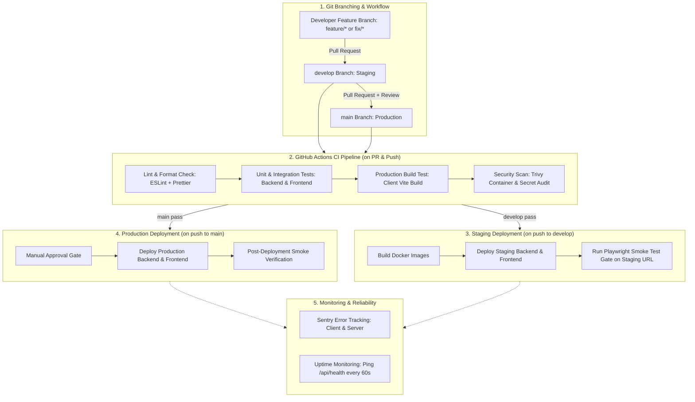

# LINKORA DevOps Audit & Current Architecture Report

**Document ID**: `docs/devops/01-deployment-audit.md`  
**Phase**: Phase 0 — Audit Existing Project and Deployment  
**Status**: Completed  
**Author**: Antigravity DevOps & Senior Software Engineering Team  
**Date**: November 2026  

---

## 1. Executive Summary

LINKORA is a full-stack SaaS application built for modern SEO teams, growth leads, and link builders. It provides end-to-end backlink tracking, domain metric discovery, automated lost backlink monitoring, email outreach management, AI-driven SEO insights (via OpenAI), and visual reports and analytics.

This audit report establishes the technical baseline of the repository, analyzes its current architecture, identifies architectural gaps and potential risks, and outlines the target DevOps, CI/CD, and automation strategy to transition LINKORA into an enterprise-grade, highly reliable cloud SaaS platform.

> [!IMPORTANT]
> **Audit Status**: Phase 0 is an **Audit-Only** phase. No source code, business logic, or infrastructure files were modified, committed, stashed, or discarded during this audit. Existing uncommitted working tree files from Phase 13 (Analytics module) have been documented and preserved intact.

---

## 2. Repository & Working Tree State

### 2.1 Git Topology
- **Active Branch**: `main` (synchronized with `origin/main` at commit `fd81a9b`).
- **Remote URL**: `git@github.com:Aryantiwarib/Backlink-Management-Project.git`.
- **Existing Branches**:
  - Local: `main`
  - Remote: `origin/main`
  - *Observation*: No intermediate development branches (`develop`, `staging`, `feature/*`, `hotfix/*`) currently exist.

### 2.2 Uncommitted Working Tree Audit
A review of `git status` reveals the following modifications and additions from Phase 13 (Reports & Analytics):
- **Modified Tracked Files**:
  - `client/src/App.jsx` — Route registration for `/analytics` and `/reports`.
  - `client/src/layouts/Sidebar.jsx` — Navigation link and icon for Reports & Analytics.
- **Untracked Files**:
  - `client/src/components/analytics/CampaignAnalyticsTab.jsx`
  - `client/src/components/analytics/ExecutiveReportModal.jsx`
  - `client/src/components/analytics/OutreachAnalyticsTab.jsx`
  - `client/src/components/analytics/ProspectAnalyticsTab.jsx`
  - `client/src/components/analytics/SeoInsightsSection.jsx`
  - `client/src/pages/AnalyticsPage.jsx`
  - `server/tests/analyticsModule.test.js`
  - `server/tests/analyticsRoutes.test.js`
- **Preservation Policy**: These files are verified, functional, and preserved in the working tree. They will be staged and committed cleanly during Phase 1 alongside the Git workflow rollout.

---

## 3. Technology Stack & Architecture Baseline

### 3.1 Frontend (`client/`)
| Component | Technology | Version | Purpose |
| :--- | :--- | :--- | :--- |
| **Framework** | React | `18.3.1` | Core UI library |
| **DOM Renderer** | React-DOM | `18.3.1` | DOM bindings |
| **Build Tool & Dev Server** | Vite | `6.0.1` (`@vitejs/plugin-react` `4.3.4`) | High-speed ESM bundler & HMR server |
| **Client Routing** | React Router DOM | `6.28.0` | Client-side routing with nested layouts |
| **Server State / Cache** | TanStack React Query | `5.108.4` | Data caching, background refetching, mutation management |
| **Styling Engine** | Tailwind CSS | `3.4.16` | Utility-first styling with PostCSS (`8.4.49`) & Autoprefixer (`10.4.20`) |
| **Charts & Visualization** | Recharts | `2.13.3` | Responsive SVG charts (KPI trends, link velocity, distribution) |
| **Iconography** | Lucide React | `0.460.0` | Modern UI icon set |
| **Build Output** | SPA Static Bundle | — | Emits `index.html` + hashed assets to `client/dist/` (build time: ~1.7s) |

#### Scripts Defined in `client/package.json`:
- `npm run dev`: Runs Vite dev server on port 5173.
- `npm run build`: Executes `vite build` into `client/dist/`.
- `npm run preview`: Locates and previews the production build locally.
- *Missing Scripts*: No `lint`, `format`, or `test` scripts are configured.

---

### 3.2 Backend (`server/`)
| Component | Technology | Version | Purpose |
| :--- | :--- | :--- | :--- |
| **Runtime Environment** | Node.js (ESM) | `v24.15.0` (Active on host) | ECMAScript Module backend runtime (`"type": "module"`) |
| **Web Framework** | Express | `4.21.2` | REST API routing and HTTP request handling |
| **Database ODM** | Mongoose | `9.12.2` | MongoDB object data modeling and validation |
| **Session Management** | Express-Session | `1.19.0` | Server-managed authenticated user sessions |
| **Session Persistence** | Connect-Mongo | `6.0.0` | MongoDB-backed session store with 7-day TTL |
| **Authentication Engine** | Passport.js | `0.7.0` | Pluggable authentication framework |
| **Local Auth Strategy** | Passport-Local + Bcryptjs | `1.0.0` / `3.0.3` | Password hashing (salt rounds: 10) and credential verification |
| **OAuth 2.0 Strategy** | Passport-Google-OAuth20 | `2.0.0` | Google Single Sign-On and profile synchronization |
| **API Rate Limiting** | Express-Rate-Limit | `8.7.5` | DDoS and brute-force mitigation on authentication endpoints |
| **CORS Middleware** | CORS | `2.8.5` | Origin validation with `credentials: true` and full HTTP method support |
| **Third-Party APIs** | Google APIs (`googleapis`) | `190.0.0` | Gmail API integration for sequence dispatching |
| **AI Integration** | OpenAI SDK (`openai`) | `7.64.0` | Node SDK for AI SEO Assistant multi-turn function calling |
| **Development DB Fallback** | MongoDB Memory Server | `11.3.0` | Zero-config in-memory database fallback for local resilience |

#### Scripts Defined in `server/package.json`:
- `npm run start`: Executes `node server.js`.
- `npm run dev`: Executes `node --watch server.js`.
- *Missing Scripts*: No `test`, `lint`, or `engines` fields are declared in `server/package.json`.

---

### 3.3 Root Orchestration (`package.json`)
- `npm run dev`: Runs `concurrently "npm run server" "npm run client"`.
- `npm run server`: Launches backend development server (`--prefix server`).
- `npm run client`: Launches frontend development server (`--prefix client`).
- `npm run build`: Builds client production assets (`--prefix client`).
- `npm run start`: Starts backend in production (`--prefix server`).
- `npm run install:all`: Installs root, server, and client dependencies sequentially.

---

### 3.4 Database Architecture & Resiliency
- **Database Engine**: MongoDB (configured via `MONGODB_URI` pointing to MongoDB Atlas or local daemon).
- **Embedded Resiliency**: `server/config/db.js` provides automatic sanitization:
  - Detects unpopulated `<password>` placeholders in connection URIs.
  - Automatically recovers in development environments by spinning up `mongodb-memory-server` if Atlas is unreachable or unconfigured.
  - In production (`NODE_ENV=production`), fails fast with explicit error logging to prevent running on ephemeral memory.
- **Core Collections / Schemas**:
  1. `User`: Account credentials, OAuth profiles, role permissions.
  2. `Website`: Monitored domains, verification tokens, Moz metrics cache.
  3. `Backlink`: Individual backlinks, anchor text, target URLs, initial discovery dates.
  4. `BacklinkSnapshot`: Time-series historical records for trend calculation.
  5. `MonitoringLog`: Backlink audit run logs, status change flags (new, lost, unchanged).
  6. `Campaign`: Link outreach campaigns, targets, timelines, status (`active`, `paused`, `completed`).
  7. `Prospect`: Domain targets, discovery keywords, quality evaluation, outreach stage.
  8. `ConnectedAccount`: OAuth tokens for Gmail outreach email dispatching.
  9. `OutreachTemplate` & `OutreachSequence`: Multi-step email drip templates.
  10. `OutreachEmailLog`: Dispatch records, open/reply event logs.
  11. `ChatConversation` & `ChatMessage`: Persistent chat logs for the AI Assistant.

---

### 3.5 Health Check & System Monitoring
- **Backend Health Check**:
  - **Endpoint**: `GET /api/health` (Public, no authentication required).
  - **Implementation**: `server/app.js` (lines 91–100).
  - **Response Payload**:
    ```json
    {
      "status": "healthy",
      "uptime": 142.54,
      "timestamp": "2026-11-27T04:15:30.000Z",
      "service": "Linkora Backend API",
      "database": "connected",
      "version": "1.0.0"
    }
    ```
  - **HTTP Status Codes**: Returns `200 OK` when the service is responsive. Evaluates `mongoose.connection.readyState === 1` for database health.
- **Frontend Health Check**: Static file serving (`index.html` responds with `200 OK`).

---

### 3.6 Automated Testing Audit
Currently, 20 test files reside inside `server/tests/`:
1. `aiAssistant.test.js`
2. `aiAssistantRoutes.test.js`
3. `analyticsModule.test.js`
4. `analyticsRoutes.test.js`
5. `applicationFunctionalAudit.test.js`
6. `corsAndPatchValidation.test.js`
7. `dataConsistency.test.js`
8. `mozSyncBacklinks.test.js`
9. `phase10Campaigns.test.js`
10. `phase10RuntimeDiscoveryDebugging.test.js`
11. `phase10UpgradeDiscoveryPipeline.test.js`
12. `phase11DispatchBackendUrl.test.js`
13. `phase11Outreach.test.js`
14. `phase7BacklinkExplorer.test.js`
15. `phase8Monitoring.test.js`
16. `phase9Prospecting.test.js`
17. `testCampaignCreationController.js`
18. `testCampaignOutreachIntegration.test.js`
19. `testGoogleOAuthFlow.test.js`
20. `testProspectAssignmentSelection.js`

#### Findings on Current Testing:
- All tests are written using Node's built-in `node:assert/strict` and direct `fetch`/`http.createServer(app)`.
- Tests are executed standalone with `node server/tests/<filename>.js`.
- There is **no unified test runner** (Jest, Vitest, or Mocha) configured in `server/package.json` or root `package.json`.
- There is **no test script** (`npm test` in `package.json`).
- There are **no frontend tests** (no React Testing Library or Vitest in `client/`).
- There are **no End-to-End (E2E) browser tests** (no Playwright or Cypress configured).

---

### 3.7 Environment Variables & Secrets Management
- Template files exist:
  - `server/.env.example` (Defines `PORT`, `NODE_ENV`, `CLIENT_URL`, `BACKEND_URL`, `MONGODB_URI`, `SESSION_SECRET`, `GOOGLE_*`, `SEO_PROVIDER`, `MOZ_API_TOKEN`, `DATAFORSEO_*`, `OPENAI_*`).
  - `client/.env.example` (Defines `VITE_BACKEND_URL`, `VITE_API_URL`).
- `.gitignore` properly excludes `.env`, `.env.local`, `.env.*.local`.
- Live secrets are kept in untracked `.env` files locally.
- There is currently no automated secret scanning (such as Gitleaks or Trivy) in CI.

---

## 4. Current Deployment Flow & Infrastructure Status

| Domain | Current State | Target DevOps State |
| :--- | :--- | :--- |
| **Hosting Provider** | Localhost execution (`5173` & `5002`); architecture ready for Render (Backend) & Vercel (Frontend) or Cloud Containers | Formalized multi-environment hosting (Staging & Production) |
| **CI/CD Automation** | None (no `.github/workflows/`) | GitHub Actions pipeline with Lint, Test, Build, and Scan jobs |
| **Containerization** | None (no `Dockerfile` or `docker-compose.yml`) | Multi-stage Dockerfiles with Alpine base, non-root users, and Docker Compose orchestration |
| **Branching & Environments**| Single `main` branch, direct commits | Git flow: `feature/*` $\rightarrow$ `develop` (auto-staging) $\rightarrow$ `main` (manual-approved production) |
| **Testing in Pipeline** | None | Automated unit, integration, and Playwright staging smoke tests |
| **Quality Gates** | None | ESLint + Prettier automated checks + Dependabot security updates |
| **Container & Secret Security** | None | Trivy vulnerability scanner + Trivy secret scanner |
| **Error Monitoring** | Local terminal logs | Sentry error monitoring for frontend and backend |
| **Uptime Monitoring** | None | Uptime Kuma or hosted health check pinging `/api/health` |

---

## 5. Potential Risks & Bottlenecks

1. **Risk 1: Unprotected Production Branch**
   - Currently, all work is on `main`. Without a `develop` branch or branch protection rules (requiring status checks and PR approvals), accidental breaks could hit production directly.
2. **Risk 2: Lack of Container Standardization (Environment Drift)**
   - The developer machine runs macOS with Node `v24.15.0`. Cloud hosts and CI runners often run Linux with Node `20` or `22`. Without Docker, dependency behavior (such as native binary bindings in `bcryptjs` or OpenSSL versions) can diverge between local and cloud environments.
3. **Risk 3: In-Process Background Schedulers**
   - The monitoring and email queue schedulers run in the same process as the web server (`server.js`). If the backend container is horizontally scaled to multiple replicas without distributed locks, jobs will execute redundantly.
4. **Risk 4: Large Client Chunk Size**
   - Client production build outputs a single chunk (`index-Dp10IjKW.js` at 1.3 MB minified / 311 kB gzipped), triggering Vite's chunk warning. While functional, it will benefit from lazy routing and code-splitting.
5. **Risk 5: Tests Lack a Standard Runner**
   - Running 20 individual `node server/tests/*.js` scripts in CI requires a custom orchestrator unless standardized into an `npm test` script.

---

## 6. Recommended DevOps Architecture for LINKORA



---

## 7. Toolchain Selection: Required vs. Postponed

To adhere to the principle of minimal necessary complexity, tools are evaluated based on actual project requirements:

### 7.1 Required Tools (To Implement Across Phases 1–14)
1. **Git Flow Workflow**: `main`, `develop`, and `feature/*` branches with clear conventions.
2. **Docker & Docker Compose**:
   - `client/Dockerfile`: Multi-stage build (Node build $\rightarrow$ Nginx Alpine static server).
   - `server/Dockerfile`: Multi-stage build (Node Alpine with dumb-init/tini, non-root user).
   - `docker-compose.yml`: Local full-stack environment including MongoDB service.
3. **Automated Testing Suite**:
   - Unit tests for services and controllers.
   - Supertest API integration tests against Express routes.
   - Playwright end-to-end smoke test gate for staging.
4. **Code Quality & Dependency Automation**:
   - ESLint and Prettier configured with single npm scripts.
   - GitHub Dependabot (`.github/dependabot.yml`) for security alerts.
5. **Security Automation**:
   - Trivy vulnerability scanner in GitHub Actions.
   - Secret scanning in Git repository.
6. **GitHub Actions CI/CD Workflows**:
   - `.github/workflows/ci.yml`: Multi-job pipeline (lint, test, build, scan).
   - `.github/workflows/staging.yml`: Automated trigger on `develop`.
   - `.github/workflows/production.yml`: Approval-gated production deploy on `main`.
7. **Observability**:
   - Sentry configuration documentation and code initialization hooks.
   - Uptime monitoring configuration targeting `/api/health`.

### 7.2 Postponed / Not Recommended Tools
- **Kubernetes (K8s)**: Excessive overhead for current traffic and application scale. Docker Compose and PaaS/container services (Render/Railway/ECS/Cloud Run) provide ideal simplicity and lower operating costs.
- **Terraform / CloudFormation**: Overkill before multi-region infrastructure or custom VPC requirements emerge.
- **Complex Service Mesh (Istio/Linkerd)**: Unnecessary for a 2-service (client + server) architecture.

---

## 8. Implementation Roadmap (Phases 1–14)

- **Phase 1**: Git Branching Strategy & Workflow (`docs/devops/02-git-workflow.md`).
- **Phase 2**: Docker Containerization (`docs/devops/03-docker-setup.md`, Dockerfiles, Compose).
- **Phase 3**: Automated Testing Setup (`docs/devops/04-automated-testing.md`, Jest/Supertest/Playwright).
- **Phase 4**: Code Quality & Dependabot (`.github/dependabot.yml`, ESLint/Prettier).
- **Phase 5**: Security Automation (`docs/devops/05-security.md`, Trivy).
- **Phase 6**: GitHub Actions CI Pipeline (`docs/devops/06-github-actions-ci.md`, `.github/workflows/ci.yml`).
- **Phase 7**: Staging Environment Architecture (`docs/devops/07-staging-deployment.md`).
- **Phase 8**: Continuous Delivery & Production Deployment (`docs/devops/08-production-deployment.md`).
- **Phase 9**: Playwright Staging Test Gate.
- **Phase 10**: Sentry Error Monitoring Setup (`docs/devops/09-monitoring.md`).
- **Phase 11**: Uptime Monitoring (`docs/devops/10-uptime-monitoring.md`).
- **Phase 12**: Final CI/CD Architecture Synthesis.
- **Phase 13**: Dedicated DevOps Documentation Library (`docs/devops/01`–`11`).
- **Phase 14**: Final Verification across all DevOps pillars.

---

## 9. Conclusion & Immediate Recommendation

The codebase is structurally sound, clean, and possesses strong architectural separation between the Vite React frontend, the Express REST API, and MongoDB Atlas. With the health check already in place and existing test suites covering core business domains, the application is in an ideal state to receive a complete, modern DevOps automation pipeline.

**Next Step**: Present this audit report to the user and obtain approval to proceed to **Phase 1: Git Branching Strategy & Workflow**.
