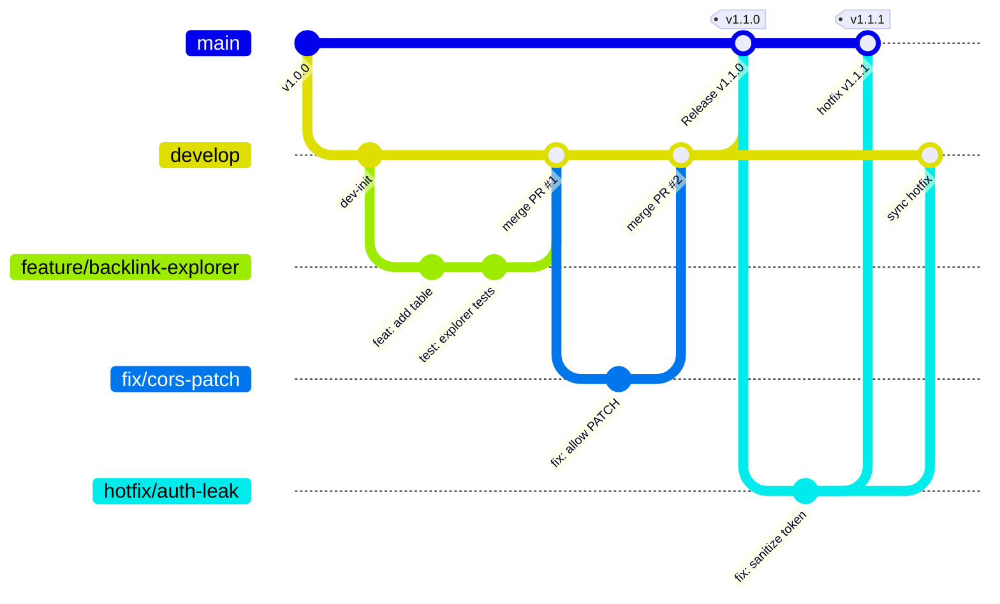

# LINKORA Git Branching Strategy & Engineering Workflow

**Document ID**: `docs/devops/02-git-workflow.md`  
**Phase**: Phase 1 — Git Branching Strategy & Workflow  
**Status**: Active & Implemented  
**Author**: Antigravity DevOps Team  
**Date**: November 2026  

---

## 1. Overview & Objectives

To guarantee stability, auditability, and zero downtime in production, LINKORA follows a disciplined Git workflow. This strategy guarantees that:
1. **Production stability**: The `main` branch always represents deployable, verified production code.
2. **Staging parity**: The `develop` branch reflects the continuous integration state, automatically verified and deployed to the staging environment.
3. **Isolated development**: All feature development and bug fixes occur on ephemeral, dedicated branches (`feature/*`, `fix/*`, `hotfix/*`).
4. **Traceability**: Commit history follows the **Conventional Commits** specification to enable automated changelogs and semantic versioning.

---

## 2. Branch Architecture



### 2.1 Branch Taxonomy

| Branch | Base Branch | Target / Merge Branch | Purpose | Deployment Target |
| :--- | :--- | :--- | :--- | :--- |
| `main` | — | Protected (No direct push) | Production release branch. Only receives tested code via Pull Requests from `develop` or critical `hotfix/*`. | Production |
| `develop` | `main` | `main` (via release PR) | Staging integration branch. All completed features and regular fixes merge here. | Staging |
| `feature/*` | `develop` | `develop` | New features, UI additions, new API integrations. Example: `feature/ai-chat-history`. | Local / Staging preview |
| `fix/*` | `develop` | `develop` | Non-emergency bug fixes, regression resolutions, UI polish. Example: `fix/cors-preflight`. | Local / Staging |
| `hotfix/*` | `main` | `main` AND `develop` | Emergency production patches (security flaws, data corruption, severe outages). | Staging then Production |

---

## 3. Conventional Commits Specification

All commit messages in the LINKORA repository must adhere to the [Conventional Commits](https://www.conventionalcommits.org/en/v1.0.0/) standard.

### 3.1 Format Structure
```text
<type>(<scope>): <short imperative description>

[optional body explaining WHY, context, and breaking changes]

[optional footer(s), e.g. Closes #12, BREAKING CHANGE: ...]
```

### 3.2 Types
- `feat`: A new user-facing feature or API capability (e.g., `feat(analytics): add export CSV endpoint`).
- `fix`: A bug fix (e.g., `fix(campaign): restore PATCH method in CORS header`).
- `docs`: Documentation updates only (e.g., `docs(devops): document Git branching model`).
- `style`: Changes that do not affect the meaning of the code (formatting, semicolon cleanup).
- `refactor`: A code change that neither fixes a bug nor adds a feature (e.g., `refactor(auth): extract token verify helper`).
- `perf`: A code change that improves performance (e.g., `perf(query): index websiteId on BacklinkSnapshot`).
- `test`: Adding missing tests or correcting existing tests (e.g., `test(outreach): add supertest sequence dispatch suite`).
- `chore`: Build process, dependency updates, tooling configuration (e.g., `chore(docker): add multi-stage Dockerfiles`).
- `ci`: Changes to CI/CD workflows and configuration (e.g., `ci(github): add lint and test pipeline`).

### 3.3 Scope Rules
Common LINKORA scopes:
`analytics`, `assistant`, `auth`, `backlinks`, `campaigns`, `client`, `docker`, `monitoring`, `outreach`, `prospects`, `security`, `server`, `websites`.

---

## 4. Pull Request (PR) & Code Review Guidelines

1. **Branch Naming**:
   - `feature/<ticket-or-name>`: e.g. `feature/export-executive-pdf`
   - `fix/<issue-name>`: e.g. `fix/dashboard-domain-auth-mismatch`
   - `hotfix/<patch-name>`: e.g. `hotfix/session-cookie-cross-domain`

2. **PR Requirements**:
   - Every PR targeting `develop` or `main` must pass all CI checks:
     - Linting and code formatting (`npm run lint`, `npm run format:check`).
     - Automated unit and integration test suite (`npm test`).
     - Client production build verification (`npm run build`).
     - Security and vulnerability scan (`trivy`).
   - Clean git history: Avoid commit messages like `"wip"`, `"test"`, `"asdf"`. Squash or rebase messy local histories before merging.
   - At least 1 review approval from a peer or technical lead.

3. **Merge Method**:
   - Merging `feature/*` $\rightarrow$ `develop`: **Squash and Merge** or **Rebase and Merge** to maintain a linear and clear history.
   - Merging `develop` $\rightarrow$ `main`: **Merge Commit** with tag creation to preserve release grouping.

---

## 5. Release Tagging & Semantic Versioning (SemVer)

LINKORA follows [Semantic Versioning 2.0.0](https://semver.org/):
$$\text{Version} = \text{MAJOR}.\text{MINOR}.\text{PATCH}$$

- **MAJOR (X.0.0)**: Incompatible API breaks or massive architecture overhauls.
- **MINOR (1.X.0)**: Backward-compatible feature additions (e.g., Reports & Analytics module, AI Assistant).
- **PATCH (1.0.X)**: Backward-compatible bug fixes and security hotfixes.

### 5.1 Tagging Procedure
When merging a release candidate from `develop` into `main`:
```bash
# Ensure local main is synchronized
git checkout main
git pull origin main

# Create annotated git tag
git tag -a v1.1.0 -m "Release v1.1.0: Reports & Analytics, AI Assistant, and DevOps Pipeline"

# Push tag to trigger production release workflow
git push origin v1.1.0
```

---

## 6. Recommended GitHub Branch Protection Settings

To enforce this workflow on GitHub:

1. **`main` Branch**:
   - Require a pull request before merging (No direct pushes).
   - Require status checks to pass before merging:
     - `ci/lint`
     - `ci/test`
     - `ci/build`
     - `ci/security`
   - Require at least 1 approving review.
   - Require branches to be up to date before merging.
   - Restrict deletions and force pushes.

2. **`develop` Branch**:
   - Require pull requests for merging (direct pushes disabled except for release syncs).
   - Require status checks to pass (`ci/test`, `ci/build`).
   - Prevent force pushes.

---

## 7. Local Workflow Quick Reference

```bash
# 1. Start a new feature from latest develop
git checkout develop
git pull origin develop
git checkout -b feature/my-new-feature

# 2. Develop, test locally, and commit with conventional messages
git add .
git commit -m "feat(outreach): support custom drip scheduling"

# 3. Keep feature updated with develop
git fetch origin
git rebase origin/develop

# 4. Push branch and open Pull Request to develop
git push -u origin feature/my-new-feature
```
