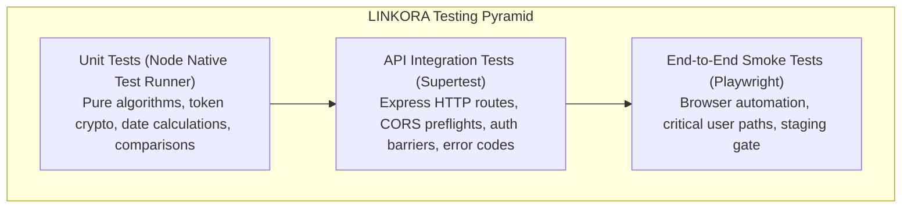

# LINKORA Automated Testing & Quality Assurance Architecture

**Document ID**: `docs/devops/04-automated-testing.md`  
**Phase**: Phase 3 — Automated Testing Setup  
**Status**: Active & Implemented  
**Author**: Antigravity DevOps Team  
**Date**: November 2026  

---

## 1. Testing Philosophy & Test Pyramid

LINKORA follows the industry standard **Testing Pyramid** to maximize test speed, minimize maintenance cost, and ensure zero regression releases:



1. **Unit Tests (Fastest, High Volume)**: Validate deterministic business logic (e.g. HMAC token encryption/decryption, date range math, delta percentage calculations).
2. **API Integration Tests (Medium Speed)**: Exercise the Express app using Supertest to confirm status codes, CORS headers, JSON schemas, and authorization middleware barriers.
3. **End-to-End Smoke Tests (Comprehensive Gate)**: Automated Chromium tests checking live page loads, DOM rendering, form inputs, and backend health status.

---

## 2. Unit Testing Suite (`server/tests/unitServices.test.js`)

- **Runner**: Node.js built-in test runner (`node:test`, `node:assert/strict`).
- **Execution Time**: ~150 ms.
- **Coverage Areas**:
  1. **HMAC-SHA256 Token Helper (`utils/tokenHelper.js`)**:
     - Signed token creation and URL-safe base64 structure.
     - Signature validation and tampering rejection.
     - Token expiration enforcement.
     - Resilience against malformed inputs (null, empty strings, numbers, objects).
  2. **Analytics Utilities (`services/analyticsService.js`)**:
     - Date range boundary calculations (`7d`, `30d`, `90d`).
     - Percentage change math ($+50\%$, $-20\%$).
     - Prevention of division by zero and fake `Infinity` percentages.
     - Handling of missing historical records.

---

## 3. Supertest API Integration Suite (`server/tests/apiIntegration.test.js`)

- **Runner**: Node.js test runner with `supertest` driving `server/app.js`.
- **Execution Time**: ~800 ms.
- **Verified Endpoints**:
  1. `GET /api/health` — Returns `200 OK` with JSON `{ status: 'healthy', database, version, uptime }`.
  2. `OPTIONS /api/campaigns/:id/status` — Preflight CORS verification, guaranteeing `PATCH` is permitted in `Access-Control-Allow-Methods` and `Access-Control-Allow-Origin` matches `CLIENT_URL`.
  3. `GET /api/auth/status` — Returns `200 OK` with `{ success: true, isAuthenticated: false, user: null }` for unauthenticated sessions.
  4. `GET /api/campaigns` — Returns `401 Unauthorized` without credentials.
  5. `GET /api/websites` — Returns `401 Unauthorized` without credentials.
  6. `GET /api/analytics/overview` — Returns `401 Unauthorized` without credentials.
  7. `GET /api/assistant/history` — Returns `401 Unauthorized` without credentials.
  8. `GET /api/unknown-endpoint` — Returns structured `404` JSON payload.

---

## 4. End-to-End Staging Smoke Suite (`tests/e2e/smoke.spec.js`)

- **Framework**: Playwright (`@playwright/test`).
- **Configuration (`playwright.config.js`)**:
  - Configurable `BASE_URL` (default: `http://localhost:5173` or staging environment URL).
  - Configurable retries on CI (`retries: 2`).
  - Automatic screenshot and trace capture on failure.
- **Test Scenarios**:
  1. **Backend Health Check**: Confirms backend connectivity via Playwright API request context.
  2. **Frontend App Load**: Navigates to `/` and validates routing to login or dashboard.
  3. **Authentication Form Render**: Confirms email input, password input, and branding are visible in the DOM.

---

## 5. NPM Testing Scripts Reference

### Root Directory
| Command | Action |
| :--- | :--- |
| `npm test` | Runs both Unit and Integration test suites sequentially |
| `npm run test:unit` | Runs backend unit tests (`node --test tests/unitServices.test.js`) |
| `npm run test:integration` | Runs API integration tests (`node --test tests/apiIntegration.test.js`) |
| `npm run test:e2e` | Runs Playwright browser smoke tests against `BASE_URL` |

### Server Directory (`server/`)
| Command | Action |
| :--- | :--- |
| `npm test` | Runs unit and integration suites in the backend context |
| `npm run test:unit` | Executes `tests/unitServices.test.js` |
| `npm run test:integration` | Executes `tests/apiIntegration.test.js` with `supertest` |

---

## 6. Continuous Integration (CI) Execution

In the GitHub Actions CI pipeline, test execution is isolated into dedicated matrix jobs:
```yaml
- name: Run Backend Unit Tests
  run: npm run test:unit

- name: Run Supertest API Integration Tests
  run: npm run test:integration
```
Any assertion failure or HTTP status mismatch halts the pipeline immediately and prevents deployment.
