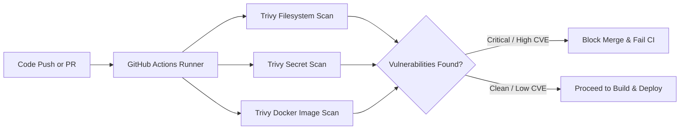

# LINKORA Security Architecture & Vulnerability Management

**Document ID**: `docs/devops/05-security.md`  
**Phase**: Phase 5 — Security Automation  
**Status**: Active & Implemented  
**Author**: Antigravity DevOps Team  
**Date**: November 2026  

---

## 1. Overview & Threat Model

LINKORA handles sensitive user data, including SEO analytics, Google OAuth refresh tokens, Gmail outreach sequences, and OpenAI API credentials. Ensuring multi-layered defense against data leakage, container breakout, and dependency vulnerabilities is a primary architectural mandate.

### Key Security Objectives
1. **Zero Secret Leakage**: Strict file exclusion policies and automated pre-commit / CI scanning to prevent credentials from ever entering version control.
2. **Minimal Attack Surface**: Alpine Linux base images (`node:20-alpine`, `nginx:1.27-alpine`), unprivileged non-root execution (`USER node`), and minimal runtime dependencies.
3. **Automated Vulnerability Scanning**: Continuous scanning of repositories, npm dependencies, Docker layers, and infrastructure configurations via Aqua Security's **Trivy**.
4. **Data at Rest & Transit Encryption**: AES-256-GCM encryption for stored OAuth tokens (`server/utils/crypto.js`) and TLS/HTTPS for all external communication.

---

## 2. Secret Protection Audit & Hygiene

### 2.1 Git History Audit
A historical audit across all branches (`git log --all --full-history -- "**.env*"`) confirms:
- **Clean History**: Zero live `.env` files, production credentials, database connection strings, or third-party API tokens have ever been committed.
- **Example Templates Only**: Only sanitized templates (`server/.env.example` and `client/.env.example`) with dummy values (e.g. `your_moz_api_token_here`) exist in the repository.

### 2.2 Comprehensive Git Exclusion (`.gitignore`)
The root `.gitignore` enforces strict wildcard protection:
```gitignore
# Environment variables
.env
.env.*
!.env.example
.env.local
.env.development.local
.env.test.local
.env.production.local
```
This guarantees that custom developer files like `.env.staging`, `.env.prod`, or `.env.backup` are automatically excluded.

### 2.3 Secrets Hierarchy by Environment
| Environment | Storage Mechanism | Access Control |
| :--- | :--- | :--- |
| **Local Development** | Untracked `server/.env` and `client/.env` | Individual developer machine only |
| **CI/CD Pipeline** | GitHub Actions Encrypted Secrets (`${{ secrets.* }}`) | Repository admins / restricted workflow runners |
| **Staging** | Staging Cloud Provider Dashboard / KMS | Restricted team leads, non-production credentials |
| **Production** | Production Cloud Provider Secrets (e.g., Render/AWS/GCP KMS) | Production admins, strictly segregated production credentials |

---

## 3. Automated Vulnerability Scanning with Trivy

LINKORA leverages **Trivy** (Aqua Security) in both local CLI verification and the GitHub Actions CI pipeline.



### 3.1 What Trivy Scans
1. **OS Vulnerabilities**: Checks Alpine base packages (`apk`) for known CVEs.
2. **Dependency Vulnerabilities**: Audits `package-lock.json` against the National Vulnerability Database (NVD) and GitHub Advisory Database.
3. **Secret Scanning**: Searches for API keys, private certificates, JWT tokens, and database connection strings committed inadvertently.
4. **Misconfiguration Scanning**: Validates Dockerfiles against CIS benchmarks (e.g., verifying `USER` instruction is not root).

### 3.2 Trivy in GitHub Actions
```yaml
- name: Run Trivy Vulnerability Scanner (Repo & Dependencies)
  uses: aquasecurity/trivy-action@0.29.0
  with:
    scan-type: 'fs'
    scan-ref: '.'
    format: 'table'
    exit-code: '1'
    ignore-unfixed: true
    severity: 'CRITICAL,HIGH'
```

---

## 4. Vulnerability Response SLA & Remediation Protocol

When a vulnerability is flagged by Trivy, Dependabot, or an automated audit, the following Service Level Agreement (SLA) applies:

| Severity | Target Resolution Time | Action Required |
| :--- | :--- | :--- |
| **CRITICAL** | < 24 Hours | Immediate patch, rebuild container image, deploy hotfix to production. |
| **HIGH** | < 72 Hours | Investigate impact on application code, upgrade dependency, verify test suites. |
| **MEDIUM** | Next Sprint (14 Days) | Scheduled dependency upgrade via Dependabot. |
| **LOW / INFO** | Regular Maintenance | Evaluated during routine dependency reviews. |

### 4.1 Remediation Steps
1. **Dependency CVE**: Run `npm audit fix` or upgrade the specific package in `server/package.json` or `client/package.json`.
2. **Base Image CVE**: Update the Alpine patch version in `Dockerfile` (e.g., `node:20-alpine` rebuilds with the latest Alpine security patches).
3. **Verification**: Run `npm test` locally to verify zero regressions before merging to `develop`.
