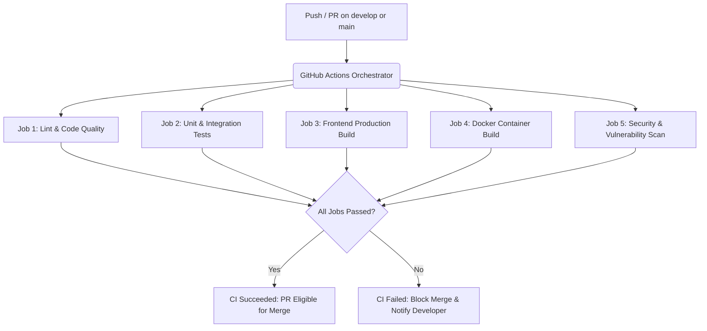

# LINKORA Continuous Integration (CI) Pipeline Guide

**Document ID**: `docs/devops/06-github-actions-ci.md`  
**Phase**: Phase 6 — GitHub Actions CI Pipeline  
**Status**: Active & Implemented  
**Author**: Antigravity DevOps Team  
**Date**: November 2026  

---

## 1. Overview & Objectives

The LINKORA CI Pipeline automates validation on every commit and Pull Request. It ensures that no code enters `develop` (staging) or `main` (production) without passing code quality checks, automated tests, build verification, and container security audits.



---

## 2. Pipeline Configuration (`.github/workflows/ci.yml`)

### 2.1 Triggers & Concurrency
- **Triggers**:
  - Direct pushes to `main` and `develop`.
  - Pull Requests targeting `main` and `develop`.
- **Concurrency Control**:
  - Automatically cancels obsolete in-progress workflow runs when a developer pushes new commits to the same branch or PR (`cancel-in-progress: true`), saving GitHub Actions minutes.

---

## 3. Job Breakdown & Execution Details

### 3.1 Job 1: `lint` (Code Quality & Linting)
- **Environment**: Ubuntu Latest, Node.js 20.x.
- **Commands**: `npm ci` $\rightarrow$ `npm run lint`.
- **Validation**: Checks JS/JSX syntax, unused variables, and style violations across frontend and backend.

### 3.2 Job 2: `test` (Unit & Integration Tests)
- **Environment**: Ubuntu Latest, Node.js 20.x.
- **Commands**:
  - `npm run test:unit`: Executes pure unit tests (`server/tests/unitServices.test.js`).
  - `npm run test:integration`: Executes Supertest API tests against Express (`server/tests/apiIntegration.test.js`).
- **Environment Flags**: Injects `NODE_ENV=test` and `SESSION_SECRET` for isolated ephemeral execution.

### 3.3 Job 3: `build` (Frontend Production Build)
- **Environment**: Ubuntu Latest, Node.js 20.x.
- **Commands**: `npm --prefix client ci` $\rightarrow$ `npm --prefix client run build`.
- **Artifact Upload**: Uploads compiled `client/dist/` assets to GitHub Actions artifact storage via `actions/upload-artifact@v4` with a 7-day retention period.

### 3.4 Job 4: `docker-build` (Container Verification)
- **Environment**: Ubuntu Latest with Docker Buildx.
- **Commands**:
  - Compiles `server/Dockerfile` into `linkora-server:ci-test`.
  - Compiles `client/Dockerfile` into `linkora-client:ci-test`.
- **Purpose**: Catches broken Alpine packages, missing files in `.dockerignore`, or Nginx configuration errors before code merges.

### 3.5 Job 5: `security` (Trivy Vulnerability Scan)
- **Action**: `aquasecurity/trivy-action@0.29.0`.
- **Scope**: Filesystem repository scan, checking npm dependencies for known CRITICAL and HIGH severity CVEs.

---

## 4. Local Reproduction & Troubleshooting

If a CI job fails in GitHub Actions, reproduce it locally with the exact same commands:

```bash
# 1. Reproduce Lint Failure
npm run lint

# 2. Reproduce Test Failure
npm run test:unit
npm run test:integration

# 3. Reproduce Build Failure
npm --prefix client run build

# 4. Reproduce Docker Failure
docker build -t test-server ./server
docker build -t test-client ./client
```
