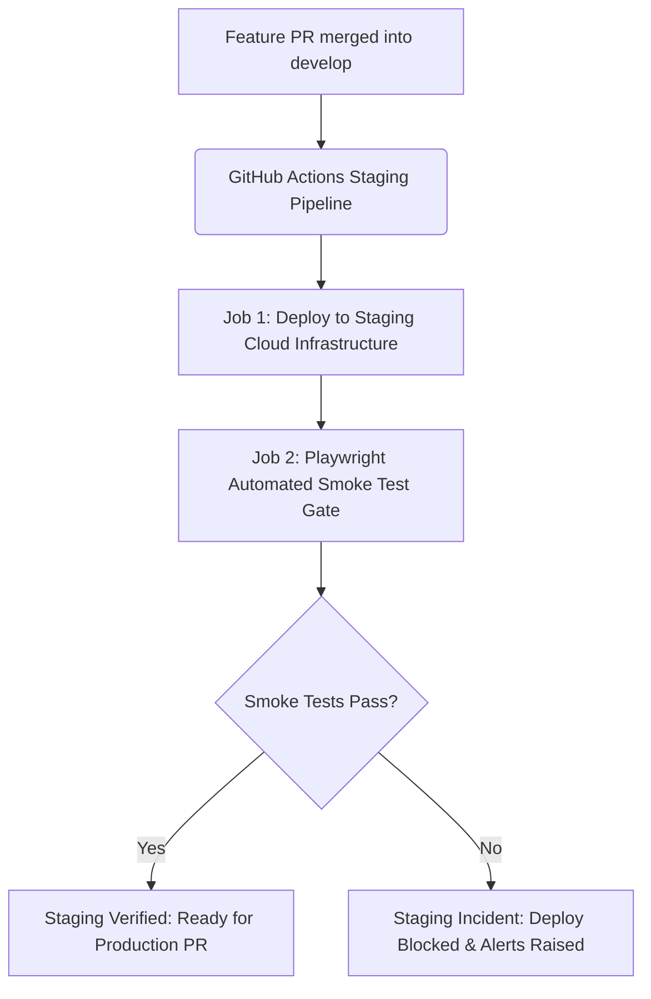

# LINKORA Staging Environment & Continuous Delivery Guide

**Document ID**: `docs/devops/07-staging-deployment.md`  
**Phase**: Phase 7 — Staging Deployment & Phase 9 Playwright Gate  
**Status**: Active & Implemented  
**Author**: Antigravity DevOps Team  
**Date**: November 2026  

---

## 1. Overview & Architecture

The **Staging Environment** serves as a non-production replica of LINKORA where new features, bug fixes, and database migrations are automatically deployed and verified before release to users.

---

## 2. Staging Configuration & Secrets

In GitHub repository settings under **Settings > Environments > `staging`**, the following parameters should be configured:

| Name | Type | Description |
| :--- | :--- | :--- |
| `STAGING_DEPLOY_WEBHOOK` | Secret | Deploy hook URL provided by cloud hosting (e.g., Render, Railway, or Vercel deploy hook) |
| `STAGING_CLIENT_URL` | Variable | Public URL of the staging web app (e.g. `https://your-staging-frontend.onrender.com` or `https://your-staging.vercel.app`) |
| `STAGING_BACKEND_URL` | Variable | Public URL of the staging backend API (e.g. `https://your-staging-api.onrender.com`) |

---

## 3. Automated Smoke Test Gate (Phase 9 Integration)

Whenever code lands on `develop`, the pipeline deploys to staging and immediately launches automated Playwright end-to-end smoke tests against `STAGING_CLIENT_URL`:
- Verifies that `/api/health` returns `status: 'healthy'` and database connectivity is active.
- Verifies frontend HTML/JS bundles render cleanly without white screens of death.
- Validates the authentication interface and critical user path readiness.
- Uploads Playwright HTML reports as pipeline artifacts for visual debugging.
