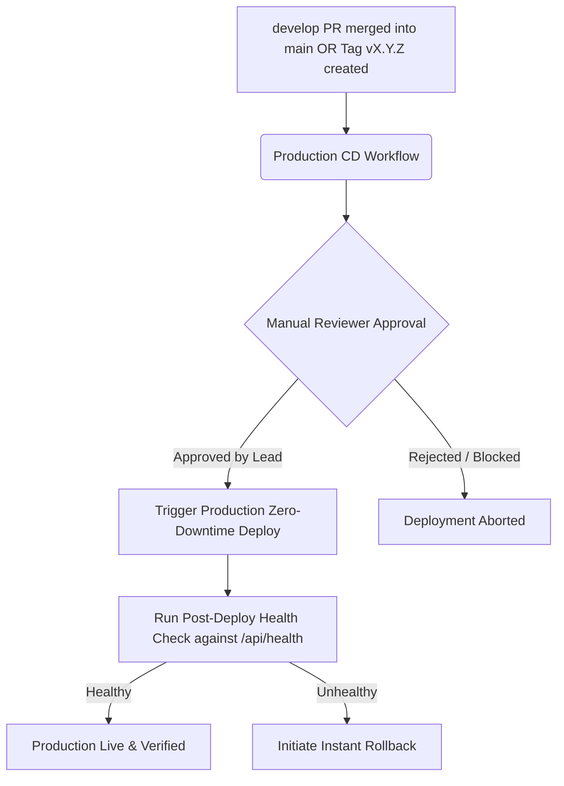

# LINKORA Production Deployment & Continuous Delivery Architecture

**Document ID**: `docs/devops/08-production-deployment.md`  
**Phase**: Phase 8 — Continuous Delivery & Production Deployment  
**Status**: Active & Implemented  
**Author**: Antigravity DevOps Team  
**Date**: November 2026  

---

## 1. Overview & Safety Architecture

Deploying to production requires zero downtime, atomic rollbacks, and explicit release authorization. LINKORA uses GitHub Actions Continuous Delivery combined with **GitHub Environment Protection Rules** to enforce manual approval gates prior to triggering production releases.



---

## 2. Production Environment Protection Rules

To configure the manual approval gate:
1. Navigate to your GitHub repository: **Settings > Environments > New environment**.
2. Name the environment: `production`.
3. Enable **Required reviewers**: Add senior engineers or repository owners.
4. Set **Deployment branches**: Restrict to `main` only.
5. Configure environment secrets:
   - `PRODUCTION_DEPLOY_WEBHOOK`: Automated deploy hook URL from your cloud hosting platform.
   - `PRODUCTION_CLIENT_URL`: Public URL of the production web application (e.g. `https://app.yourdomain.com`).
   - `PRODUCTION_BACKEND_URL`: Public URL of the production backend API (e.g. `https://api.yourdomain.com`).

---

## 3. Zero-Downtime Deployment & Instant Rollback

### 3.1 Zero-Downtime Strategy
Whether hosted on Render, Railway, AWS ECS, or Docker Compose, rolling updates ensure new container instances pass `/api/health` checks before the ingress router redirects incoming HTTP traffic from old instances.

### 3.2 Rollback Procedure
If a production issue is detected post-deployment:
1. **Cloud Dashboard Rollback**: Most modern hosting providers (Render, Vercel, Railway) support one-click rollback to the previous successful deploy in under 30 seconds.
2. **Git Revert Rollback**:
   ```bash
   git checkout main
   git revert HEAD -m 1
   git push origin main
   ```
   This triggers the automated production CD workflow with the previous stable state.
