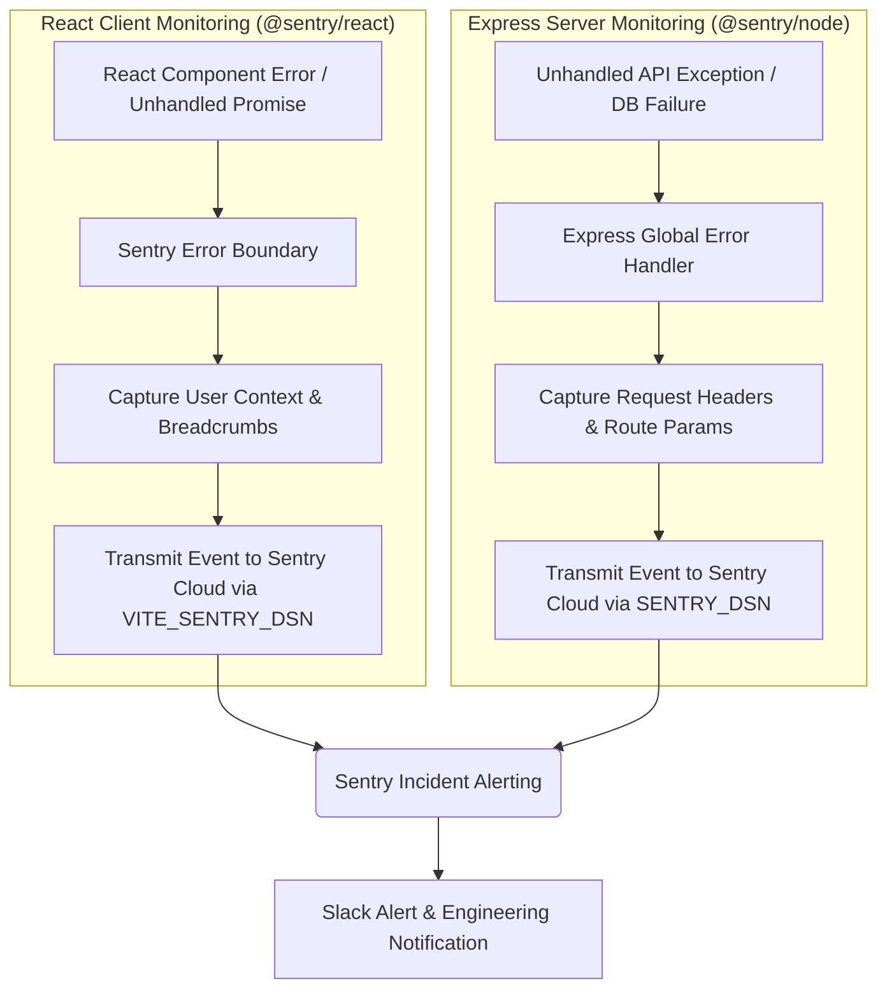

# LINKORA Application Error Monitoring Architecture (Sentry)

**Document ID**: `docs/devops/09-monitoring.md`  
**Phase**: Phase 10 — Sentry Error Monitoring Setup  
**Status**: Active & Implemented  
**Author**: Antigravity DevOps Team  
**Date**: November 2026  

---

## 1. Overview & Monitoring Strategy

To detect, diagnose, and resolve runtime exceptions before they impact users, LINKORA integrates **Sentry** for full-stack error tracking across the React frontend and Node/Express backend.



---

## 2. Frontend Sentry Integration Pattern (`client/`)

### 2.1 Dependencies
```bash
npm --prefix client install @sentry/react
```

### 2.2 Client Initialization Hook (`client/src/main.jsx`)
```javascript
import * as Sentry from '@sentry/react';

if (import.meta.env.VITE_SENTRY_DSN && import.meta.env.PROD) {
  Sentry.init({
    dsn: import.meta.env.VITE_SENTRY_DSN,
    environment: import.meta.env.MODE,
    integrations: [
      Sentry.browserTracingIntegration(),
      Sentry.replayIntegration()
    ],
    tracesSampleRate: 0.1,
    replaysSessionSampleRate: 0.05,
    replaysOnErrorSampleRate: 1.0
  });
}
```

---

## 3. Backend Sentry Integration Pattern (`server/`)

### 3.1 Dependencies
```bash
npm --prefix server install @sentry/node
```

### 3.2 Express Initialization (`server/app.js`)
```javascript
import * as Sentry from '@sentry/node';

if (process.env.SENTRY_DSN && process.env.NODE_ENV === 'production') {
  Sentry.init({
    dsn: process.env.SENTRY_DSN,
    environment: process.env.NODE_ENV,
    tracesSampleRate: 0.1
  });

  // The request handler must be the first middleware on the app
  app.use(Sentry.Handlers.requestHandler());
  app.use(Sentry.Handlers.tracingHandler());
}

// Global error handler in server/app.js sends error to Sentry
app.use((err, req, res, next) => {
  if (process.env.SENTRY_DSN) {
    Sentry.captureException(err);
  }
  console.error('[Linkora Server Error]:', err);
  res.status(err.status || 500).json({
    success: false,
    message: err.message || 'Internal Server Error'
  });
});
```

---

## 4. Environment Variables Configuration

| Variable | Target | Purpose |
| :--- | :--- | :--- |
| `SENTRY_DSN` | Server (`server/.env`) | Project ingestion endpoint for Node.js exceptions |
| `VITE_SENTRY_DSN` | Client (`client/.env`) | Project ingestion endpoint for browser exceptions |
| `SENTRY_AUTH_TOKEN` | CI/CD Secret | Optional token for uploading sourcemaps during build |

---

## 5. Recommended Sentry Alert Rules
1. **Critical Alert**: Trigger Slack / email alert if any unhandled 500 error exceeds 5 events within 1 minute.
2. **Regression Alert**: Trigger alert if an issue previously marked resolved reappears in a new release.
3. **Database Connectivity Alert**: Trigger alert on `MongoNotConnectedError` or Atlas timeout.
