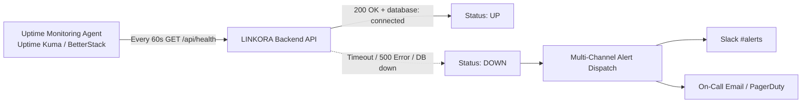

# LINKORA Uptime Monitoring & Health Verification Architecture

**Document ID**: `docs/devops/10-uptime-monitoring.md`  
**Phase**: Phase 11 — Uptime Monitoring  
**Status**: Active & Implemented  
**Author**: Antigravity DevOps Team  
**Date**: November 2026  

---

## 1. Overview & Availability SLA

LINKORA targets a $99.9\%$ monthly uptime SLA for paying SaaS customers. To detect outages, DNS failures, or database partitions instantly, continuous external uptime monitoring actively tests the application's public health endpoints.



---

## 2. Health Endpoint Specification

The monitoring probe targets the built-in health check endpoint in `server/app.js`:
- **Endpoint**: `GET /api/health`
- **Expected Status**: `200 OK`
- **Expected Content-Type**: `application/json`
- **Expected JSON Payload**:
  ```json
  {
    "status": "healthy",
    "uptime": 2341.52,
    "timestamp": "2026-11-27T04:30:00.000Z",
    "service": "Linkora Backend API",
    "database": "connected",
    "version": "1.0.0"
  }
  ```
- **Validation Criteria**:
  1. HTTP Status Code equals `200`.
  2. JSON body property `status` equals `"healthy"`.
  3. JSON body property `database` equals `"connected"`.

---

## 3. Implementation Option A: Self-Hosted Uptime Kuma

For teams that prefer self-hosting with zero monthly subscription cost, Uptime Kuma can run as an independent container service:

### Docker Compose Configuration (`docker-compose.uptime.yml`)
```yaml
services:
  uptime-kuma:
    image: louislam/uptime-kuma:1
    container_name: linkora-uptime-kuma
    restart: always
    ports:
      - "3001:3001"
    volumes:
      - uptime_data:/app/data

volumes:
  uptime_data:
```

### Setup Steps
1. Launch Uptime Kuma: `docker compose -f docker-compose.uptime.yml up -d`
2. Access web interface at `http://localhost:3001` or your public monitoring subdomain (e.g. `https://status.linkora.io`).
3. Create a new Monitor:
   - **Type**: `HTTP(s) - Keyword` or `HTTP(s) - JSON Query`
   - **Name**: `LINKORA Production API`
   - **URL**: `https://api.linkora.io/api/health`
   - **Heartbeat Interval**: `60 seconds`
   - **Retries**: `2` before notifying

---

## 4. Implementation Option B: Hosted Cloud Solutions (Recommended for Production)

Running the monitor on an external SaaS platform ensures alerts fire even if your entire cloud hosting region goes offline:

| Provider | Free Tier Availability | Strengths | Ideal Use Case |
| :--- | :--- | :--- | :--- |
| **BetterStack (Better Uptime)** | Yes (10 monitors, 3-min intervals) | Modern status pages, call alerts, screenshot tracking | SaaS startups & production status pages |
| **UptimeRobot** | Yes (50 monitors, 5-min intervals) | Industry veteran, SMS/email alerts, rock-solid | Basic HTTP endpoint uptime |
| **Pingdom** | Paid trial | Deep global multi-region probing, transaction monitoring | High-traffic enterprise |

---

## 5. Escalation & Notification Channels
1. **P1 (Critical - Outage)**: Response within 15 minutes. Channels: Slack `#alerts-prod` + SMS/Phone call via BetterStack.
2. **P2 (Degraded - High Latency > 2000ms)**: Response within 1 hour. Channels: Slack `#alerts-dev`.
3. **P3 (Maintenance / Transient spike)**: Logged to monitoring history.
